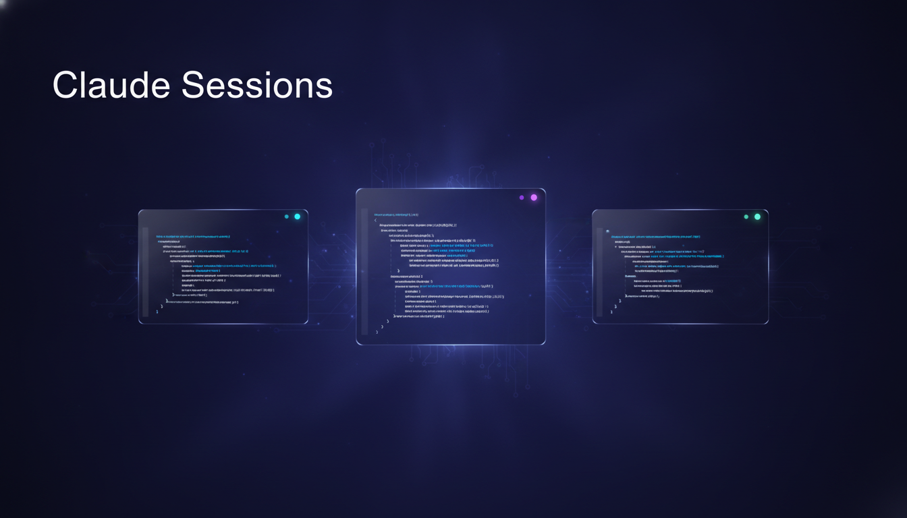
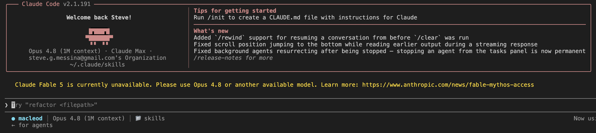

<div align="center">



[](LICENSE)


</div>

# Claude Sessions

Run several **Claude Code** accounts on one machine — isolated credentials,
distinct footers, and shared-plus-local memory — via the
`claude-config-bootstrap` skill in this repo.

One command — `claude-session` — installs the skill and bootstraps your
clients. No copying zips, no exporting environment variables by hand. Replace
`macleod` / `clientA` / `clientB` with your real client names.

---

## Quick start

```bash
git clone <this-repo> claude-sessions
cd claude-sessions
./claude-session --create macleod clientA clientB
source ~/.zshrc   # one time only — see note below
```

That's it. `--create` installs a global `claude-session` command, and for each
client creates its config dir, memory, statusline and a `cc-<client>` launcher,
and installs the `sessions` plugin (which carries the skill and keeps
everything updated, see [The plugin](#the-plugin)). The first launch logs that
account in:

```bash
cc-macleod
```

Each client runs in its own terminal. Launch as many at once as you like:

```bash
cc-macleod
cc-clientA
cc-clientB
```

A bare `claude` is disabled on purpose so you can't start an unlabeled session
against the wrong account. To bypass it deliberately:

```bash
command claude
```

> **The one-time `source`.** A script can't reload its parent shell, so the
> *first* run needs `source ~/.zshrc` (or a new terminal). After that,
> `claude-session` is installed as a shell function — available in every
> terminal and **auto-reloading your shell** after each run, so you never type
> `source` again.

<p align="center">
  
</p>
---

## Managing clients

`claude-session` is global after first install — run it from anywhere:

```bash
claude-session --create newclient   # add one or more clients
claude-session --list               # list configured clients
claude-session --delete clientA     # remove one or more clients (prompts first)
```

Every subcommand is idempotent and refreshes the launchers from the live set of
clients (the shell reloads automatically).

### The plugin

claude-sessions is also a Claude Code plugin, `sessions` in this repo's own
`claude-sessions` marketplace, so it shows in `/plugin` in every account and
updates there. `--create`/`--update` install it in every client and pool member,
with auto-update on. To add it by hand:

```
/plugin install sessions --marketplace macleodlabs-ai/claude-sessions
```

The plugin carries the skill (as `/sessions:claude-config-bootstrap`) and a
session-start hook. After `/plugin` updates it, the hook runs `--update`, so the
shared scripts, footer and launchers follow straight away.

### Updating

It updates itself. Every `cc-<client>` launch, and every running session's
footer, checks for a new version in the background at most once an hour. When
the repo has new commits, it refreshes every client: skill, memory, footer,
helper scripts and launchers. The footer and hooks are re-read on every use,
so running sessions pick up the update without a restart. Already-open shells
get new launcher functions the next time the rc file is sourced. To update right
now:

```bash
claude-session --update
```

It pulls into its own clone (`~/.claude-shared/src`), never into your checkout,
and logs automatic runs to `~/.claude-shared/update.log`. Set
`CCB_NO_AUTOUPDATE=1` to turn automatic updates off.

### Permission mode

Every `cc-<client>` launch runs in **auto** permission mode (`--permission-mode
auto`): a safety classifier approves routine actions instead of prompting for
each one. Pass a mode yourself and it wins — `cc-acme --permission-mode plan`,
or `cc-acme --dangerously-skip-permissions`. Rotations keep whatever mode the
session started with.

## Rate-limit rotation (pools)

A client can have a **rotation pool**: extra accounts (each with its own
subscription) that `cc-<client>` automatically fails over to when the active
account hits its rate limit — killing the session, relaunching under the next
account, and **resuming the same conversation** with `--resume` (~2s gap,
context intact). Clients without a pool are completely unaffected.

It's a restart+resume supervisor, not a proxy: every request is made by the
real `claude` binary using that account's own login. No tokens are extracted,
shared, or proxied.

### Upgrading an existing setup

Already running `claude-session` with clients like `macleod` / `clientA` / `clientB`?
Nothing to migrate — pool support installs over the top:

```bash
cd claude-sessions && git pull
./claude-session --pool-add macleod    # run from the repo once; upgrades itself too
```

That single command upgrades the installed `claude-session`, installs the
`cc-rotate` supervisor, and converts `macleod` to pooled mode:

1. Creates and bootstraps `~/.claude-clients/macleod-2` (memory, statusline,
   rate-limit hook) and writes the pool file
   `~/.claude-shared/pools/macleod.pool` (`macleod` first, `macleod-2` second).
2. Moves macleod's existing session history to the pool's shared location and
   symlinks it back — **all existing macleod sessions stay resumable**, now
   from any account in the pool.
3. Launches Claude under `macleod-2` so you can log the new account in
   (see below).

Other clients (`cc-clientA`, `cc-clientB`) have no pool file, so they keep launching
directly — zero behavior change.

### Logging in the new account (the login IS the connection)

There's no separate "linking" step: a pool member is just an isolated config
dir, and it's connected the moment you log a subscription into it. At the end
of `--pool-add` (or the first time you run `cc-macleod-2`) Claude's login flow
opens for the new dir:

1. In the browser OAuth page, **sign into your *second* Anthropic account** —
   the new Pro/Max subscription, *not* the one macleod already uses. If the
   browser auto-picks your usual account, switch accounts on that page.
   (Reusing the same account would mean both pool members share one rate
   limit — pointless.)
2. You're back in the terminal. Done — credentials live in
   `~/.claude-clients/macleod-2`, isolated exactly like your other clients.

Every pool member gets its own launcher, named like the label in its footer:

```bash
cc-macleod-2          # logs in first if needed, then a session on account #2
cc-macleod-2 --resume # same shared history as cc-macleod, so resume works
```

It never rotates (use `cc-macleod` for that), brings the member's MCP/plugin
setup level with the primary before launching, and warns if the member is
signed into the same account as the primary. To re-login on purpose:

```bash
claude-session --login macleod-2   # rerun the login for one account
claude-session --login macleod     # log in EVERY pool member still missing credentials
```

### Daily use

```bash
cc-macleod          # exactly as before
```

`cc-macleod` starts on your primary account. When it hits its 5-hour limit, a
`StopFailure` hook fires, the supervisor switches to `macleod-2`, and your
conversation resumes automatically (the statusline label shows which account
is active). When **every** account in the pool is limited it fails loud —
red message, soonest-reset hint, non-zero exit — never a silent fallback.

The switch is seamless by design:

- **No stall** — the supervisor submits a continuation prompt on resume, so
  the new account picks the task straight back up (previously the resumed
  session just displayed the old transcript — ending in the rate-limit error —
  and sat waiting until you typed `continue`).
- **Remote Control survives** — if `/remote-control` was active when the
  limit hit, the relaunch passes `--remote-control` and re-pairs automatically.
  The whole transcript is searched for that state, since the status line is
  written once and can sit hundreds of megabytes back in a long session.
- **Tools survive** — `skills/`, `plugins/`, `agents/`, and `commands/` are
  shared across the pool via symlinks (exactly like session history), so
  anything added mid-session on one account is instantly available on all of
  them. MCP server *definitions* live inside each account's `.claude.json`
  next to its login state, so they're synced instead of shared: on every
  rotation, at `--pool-add`, and via a `SessionEnd` hook whenever any session
  closes. Which plugins are *switched on* lives in each account's
  `settings.json`, so the rotation also merges that one key (`enabledPlugins`,
  nothing else in the file) — otherwise plugins arrive installed but off.
  OAuth-backed MCP servers (e.g. Linear) still need a one-time `/mcp`
  authenticate on each account.

```bash
claude-session --pool-add macleod      # add another account (macleod-3, ...)
claude-session --pool-list macleod     # members, rotation order, login state
claude-session --login macleod-2       # (re)log in an account by name
claude-session --usage macleod         # each account's 5h/7d usage + reset times; flags shared logins
claude-session --pin macleod-2 me@work.com  # macleod-2 must stay on that login (see below)
claude-session --rotate macleod        # switch the running cc-macleod session to the next account now
/rotate [macleod-2]                    # same, typed inside the session
cc-macleod-2                           # run account #2 directly (no rotation)
claude-session --pool-remove macleod-2 # remove an account (prompts first)
```

The pool wraps around: rotation stops only once every account has hit its
limit in a row. A manual rotation resumes without injecting a turn. In a pooled
session the footer also shows the other accounts' last-seen usage
(`↻ macleod-2 5h 8% 7d 3%`), with `⚠ same acct` when two dirs share one login.

**Each account sticks to its first login.** `/login` typed inside a
`cc-macleod` session that has rotated saves to the account active *at that
moment* (say macleod-2), and the browser usually signs in with your default
Google account, so macleod-2 could quietly end up on macleod's subscription.
So the first time a launcher or the footer sees a dir logged in, it pins the
dir to that email (`.ccb-account`) and sets `forceLoginOrgUUID` in the dir's
`settings.json`, so Claude Code itself rejects a later login into any other
account. An account another dir in the pool already holds is never pinned
twice (the earlier dir in pool order keeps it). If a dir still lands on
another member's account, the running session switches to the member that owns
it; `cc-rotate` skips the drifted dir, `cc-macleod-2` refuses to start, and the
footer shows a red `⚠ logged in as …`. `--pin` sets or changes a pin by hand;
`claude-session --login macleod` re-logs every member that has no credentials
or is on the wrong account.

Removing the last member disbands the pool: `cc-macleod` goes back to
single-account and its session history moves back into its own dir.

> **A word on terms of service.** This keeps every request inside the genuine
> Claude Code binary with that account's own OAuth login — it avoids the
> token-proxy pattern Anthropic actively bans. Rotating accounts to extend
> usage is still a gray area under Anthropic's limit-circumvention policy:
> keep it to your own subscriptions at a human pace, and know that heavy
> always-on workloads belong on API-key billing instead.

---

### Removing everything

```bash
claude-session --revert          # remove tooling, keep account dirs
claude-session --revert --force  # also delete every account dir
```

`--revert` removes the rc launcher block (restoring a normal bare `claude`), the
global command, and `~/.claude-shared`. By default your `~/.claude-clients/*`
account dirs are kept and reported (they hold real logins/history); add
`--force` to delete those too (pool members included). Add `-y`/`--yes` to skip
confirmation prompts. Pooled session history is restored to each client's
primary dir *before* the shared dir is deleted, so no transcripts are lost.

---

## Editing memory

| Want to change… | Edit this file |
|---|---|
| Shared rules (all clients) | `~/.claude-shared/global.md` |
| One client's rules | `~/.claude-clients/<client>/CLAUDE.md` — add lines **below** the `:end` marker |
| One project's rules | `CLAUDE.md` in that repo |

Never edit between the `:begin` / `:end` markers — that block is auto-managed.

---

## The footer

The statusline labels every session and carries live usage:

```
● macleod 💳 sub │ Fable 5 │ 📁 growthOS │ 🌿 main │ 🧠 10% │ ⏳ 5h 7% · 7d 1% │ $7.25 +445/-2
```

- 💳 sub / 🔑 API — what this session bills: the account's subscription, or an
  `ANTHROPIC_API_KEY`/`ANTHROPIC_AUTH_TOKEN` from the environment. The
  `cc-` launchers drop those variables for any dir logged in with a
  subscription, so an API key exported by a project's env can't take over
  (and fail with "Credit balance is too low") once claude has approved it.

- 🧠 context-window used · ⏳ 5-hour and 7-day rate-limit windows — green
  <50%, yellow 50–79%, red ≥80%; the 5h segment shows its reset time once
  it's hot (your early warning before a rotation)
- `↻ <member> 5h … 7d …` — each other pool member's last-seen usage, so you can
  see where a rotation would land; `·12m` is the reading's age, `⚠ same acct`
  means two pool dirs are logged into one subscription (rotating gains nothing)
- red `⚠ logged in as X — <dir> is pinned to Y` — the dir's login drifted off
  its pinned account (see [Each account sticks to its first login](#daily-use));
  in a rotated session it switches to the member that owns X
- session cost and lines added/removed, dimmed
- Usage comes straight from Claude Code's statusline feed (2.1.x+); on older
  versions those segments simply don't render.

---

## Check it's working

Inside a session:

- `/memory` → should list `global.md` (the shared import is loading)
- Look at the footer → shows the client name (e.g. `● macleod`)

If the footer is blank or wrong, quit and relaunch with `cc-<client>`.

---

## Troubleshooting

| Problem | Fix |
|---|---|
| `cc-macleod: command not found` | `source ~/.zshrc` (or open a new terminal) |
| Footer shows `⚪ DEFAULT` | You didn't use a `cc-` command. Quit, relaunch with `cc-<client>`. |
| Footer missing model/folder | Install jq: `brew install jq` |
| Footer didn't change after setup | Quit Claude and relaunch with `cc-<client>` |
| Rotation didn't fire on a rate limit | Check the pool member's `settings.json` has the `StopFailure` hook and that you launched via `cc-<client>` (direct `claude` runs never rotate — that's the safety gate) |
| `No conversation found with session ID` after a switch | The pool dirs must share history — `claude-session --pool-list <client>` should show every member; re-run `--pool-add` wiring by checking each dir's `projects` is a symlink into `~/.claude-shared/pools/` |
| Pool member shows `NO CREDENTIALS` | Run its launcher (`cc-<member>`, e.g. `cc-macleod-2`) — it logs in first |
| Resumed session lost MCP servers / plugins after a switch | The pool predates tooling sharing — run `~/.claude-shared/cc-pool-sync <primary-dir> <member-dir>` once per member (pools created by the current `--pool-add` get sharing automatically) |
| An OAuth MCP server (e.g. Linear) shows disconnected on one account | Expected — logins are per account. Open `/mcp` there and authenticate once |
| `Credit balance is too low` / footer shows `🔑 API` on a subscription account | An `ANTHROPIC_API_KEY` from your shell or a project `.env` was approved. Launch with `cc-<client>` (it drops the key for subscription dirs), not `command claude` |
| Footer shows a red `⚠ logged in as …` | Someone ran `/login` with the wrong account. `/login` again with the pinned one, or `claude-session --pin <dir> <email>` if the pin itself is wrong |
| `sessions` missing from `/plugin` | `claude-session --update` installs it in every client and pool member |
| A running session still has the old plugin | `/reload-plugins` in that session, or restart it |

---

## How it works

`claude-session` (repo root) owns the shell integration — the `cc-<client>`
launchers, the bare-`claude` guard, and the global, auto-sourcing
`claude-session` command — and delegates per-client memory + statusline config
to the skill's `setup.sh`. The skill ships as plain files under
`claude-config-bootstrap/` (`SKILL.md`, `README.md`, `scripts/`), delivered to
every client by the `sessions` plugin (or copied into `<config-dir>/skills/`
where the plugin is off) so Claude Code can also trigger it by name. `setup.sh`
is idempotent and self-contained. Rotation and account safety live in the
helpers `--create` installs into `~/.claude-shared/` (`cc-rotate`,
`cc-rotate-kill`, `cc-rotate-now`, `cc-member`, `cc-account-guard`,
`cc-pool-sync`). `bash tests/run.sh` runs the sandboxed regression tests; each
names the incident it guards. For the full
design, flags, and mechanics, read
[`claude-config-bootstrap/README.md`](claude-config-bootstrap/README.md).

---

## License

[MIT](LICENSE) © 2026 Macleod Labs https://macleodlabs.ai 
